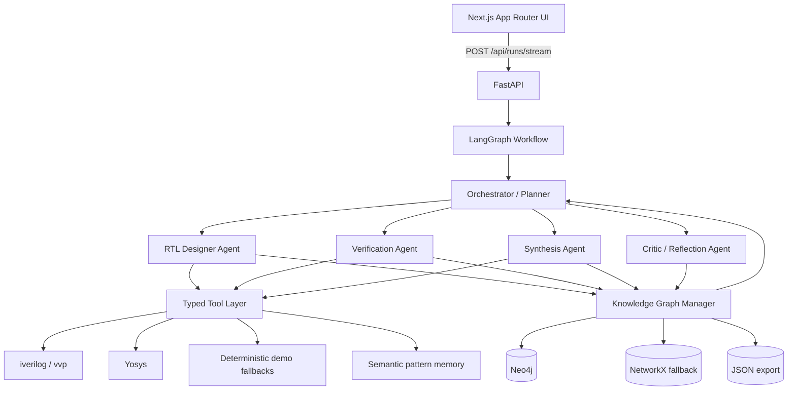

# ChipFlow Agent

ChipFlow Agent is a focused long-horizon multi-agent demo for simple digital hardware design automation. It accepts a natural-language RTL request, generates synthesizable Verilog, verifies it with simulation, runs synthesis, records the trajectory in a living knowledge graph, and exposes the run through a modern web UI.

The supported scope is intentionally narrow: counters, simple registers, FSM-like blocks, ALUs, and shift-register-style designs. The included end-to-end path is the required 4-bit up-counter with enable, asynchronous active-low reset, overflow, an intentional first-pass bug, and self-correction.

## Architecture



## File Structure

```text
chipflow-agent/
├── backend/
│   ├── agents/
│   │   ├── graph.py
│   │   └── llm.py
│   ├── knowledge_graph/
│   │   ├── manager.py
│   │   ├── neo4j_store.py
│   │   ├── rules.py
│   │   └── semantic_memory.py
│   ├── prompts/
│   ├── scripts/run_example.py
│   ├── tools/
│   │   ├── knowledge.py
│   │   ├── simulation.py
│   │   ├── synthesis.py
│   │   ├── testbench.py
│   │   └── verilog.py
│   ├── main.py
│   ├── models.py
│   ├── storage.py
│   └── requirements.txt
├── frontend/
│   ├── app/
│   ├── components/
│   ├── lib/
│   ├── package.json
│   └── tailwind.config.ts
├── examples/
├── docker-compose.yml
└── README.md
```

## Backend

The workflow is defined in `backend/agents/graph.py`. It uses LangGraph when installed and falls back to a small sequential engine when LangGraph is unavailable, preserving the same state schema and node behavior.

By default, ChipFlow does not call a paid AI model for the core EDA loop. It uses deterministic RTL/testbench tools so the required counter demo is repeatable offline. Optional model-backed review is available through the OpenAI Agents SDK:

```bash
export CHIPFLOW_AGENT_PROVIDER=openai_agents
export OPENAI_API_KEY=sk-...
# Optional. If unset, the SDK/OpenAI default model selection is used.
export CHIPFLOW_OPENAI_AGENT_MODEL=gpt-4o
```

Runtime status is exposed at:

```text
GET /api/model
GET /api/knowledge/status
GET /api/health
```

Agents:

- `Orchestrator / Planner`: decides `rtl`, `verify`, `synthesize`, `reflect`, or `finish`.
- `RTL Designer`: generates and edits Verilog using design rules and past failures.
- `Verification`: writes a self-checking testbench and runs simulation.
- `Synthesis`: runs Yosys and parses cell statistics.
- `Knowledge Graph Manager`: updates modules, ports, failures, fixes, rules, and tool outputs.
- `Critic`: checks the final trajectory before marking the run passed.

Tool adapters:

- `generate_or_edit_verilog(...)`
- `write_testbench(...)`
- `run_simulation(...)`
- `run_yosys_synthesis(...)`
- `query_knowledge_graph(...)`
- `get_relevant_design_rules(...)`
- `get_past_failures_and_fixes(...)`

OpenAI Agents SDK support lives in `backend/agents/openai_agents_sdk.py`. When enabled, the RTL designer asks an SDK-backed reviewer to inspect the candidate RTL with local function tools for design rules and recent failures. Simulation, synthesis, and quality gates still decide correctness.

The simulation adapter prefers `iverilog` + `vvp`. The synthesis adapter prefers `yosys`. If either binary is missing, the app reports the missing native tool and uses a deterministic fallback for the supported counter demo so the UI remains runnable on a bare laptop.

## Knowledge Graph

The graph uses a dual-layer design:

- **Neo4j** for persistent showcase-grade graph storage and Cypher queries.
- **NetworkX** for fast in-process agent queries and reliable local fallback.
- **JSON** export for portable run artifacts.

Set `CHIPFLOW_KG_BACKEND=neo4j` plus `NEO4J_URI`, `NEO4J_USER`, and `NEO4J_PASSWORD` to persist every graph update to Neo4j. Docker Compose enables this by default.

Node types:

- `Module`
- `Port`
- `Constraint`
- `DesignRule`
- `Failure`
- `Fix`
- `ToolOutput`
- `HierarchyEdge`-style relationships via typed edges

Edges include:

- `contains`
- `violates`
- `fixed_by`
- `depends_on`
- `applies_to`
- `produced_by`

The graph is seeded with reset polarity, async reset sensitivity, enable hold, width matching, nonblocking sequential assignment, single-clock-domain, synthesizable subset, overflow, and cell-budget rules.

Useful Neo4j demo queries are in `examples/neo4j_queries.cypher`. Example:

```cypher
MATCH (failure:Failure)-[:FIXED_BY]->(fix:Fix)
RETURN failure.label AS failure, fix.label AS fix;
```

## Local Run

Install backend dependencies:

```bash
cd chipflow-agent
python3.11 -m venv .venv
source .venv/bin/activate
pip install -r backend/requirements.txt
```

Install open-source EDA tools if available:

```bash
# macOS example
brew install icarus-verilog yosys
```

Start the API:

```bash
export CHIPFLOW_KG_BACKEND=networkx
PYTHONPATH=. uvicorn backend.main:app --reload --port 8000
```

To use local Neo4j without Docker:

```bash
export CHIPFLOW_KG_BACKEND=neo4j
export NEO4J_URI=bolt://localhost:7687
export NEO4J_USER=neo4j
export NEO4J_PASSWORD=chipflow-neo4j
PYTHONPATH=. uvicorn backend.main:app --reload --port 8000
```

Start the frontend:

```bash
cd frontend
npm install
NEXT_PUBLIC_API_BASE_URL=http://127.0.0.1:8000 npm run dev
```

Open `http://localhost:3000`.

Run the CLI example:

```bash
cd chipflow-agent
PYTHONPATH=. python backend/scripts/run_example.py
```

## Docker

```bash
cd chipflow-agent
docker compose up --build
```

The backend image installs `iverilog` and `yosys`.

Docker also starts Neo4j:

- Neo4j Browser: `http://localhost:7474`
- Bolt URI: `bolt://localhost:7687`
- User: `neo4j`
- Password: `chipflow-neo4j`

## Example Session

Prompt:

```text
Design a 4-bit synchronous up-counter with active-high enable, asynchronous active-low reset, and an overflow flag. Keep the design under 40 standard cells if possible.
```

Expected behavior:

1. The planner asks the RTL designer for an initial candidate.
2. The demo intentionally emits a reset-polarity bug on the first version.
3. Verification catches the failure.
4. The graph records the failure and links it to reset rules.
5. The RTL designer fixes the reset branch.
6. Verification passes.
7. Synthesis reports cell count and budget status.
8. The critic marks the run passed.

## API

```text
GET  /api/health
GET  /api/model
GET  /api/rules
GET  /api/knowledge/status
GET  /api/knowledge/neo4j
POST /api/knowledge/query
POST /api/knowledge/neo4j/cypher
POST /api/runs
POST /api/runs/stream
GET  /api/runs/{run_id}
GET  /api/runs/{run_id}/export
```

`POST /api/runs/stream` returns server-sent event frames with full run snapshots, allowing the UI to update code, trajectory, reports, and graph visualization as agents progress.

## Advanced Concepts Demonstrated

- Long-horizon agent loops with explicit stop conditions and iteration budgets.
- Hierarchical multi-agent orchestration using LangGraph.
- Typed tool use around RTL generation, simulation, synthesis, and graph queries.
- Structured self-correction from tool failure to graph-backed fix.
- Living Neo4j knowledge graph with rule, failure, fix, module, port, and tool-output nodes.
- Semantic memory for successful RTL patterns.
- Streaming operational trace for a web UI without exposing private chain-of-thought.

## Interview Demo Script

1. Open the UI and run the default 4-bit counter request.
2. Point out the seeded reset-polarity bug.
3. Show the verification failure and parsed failure reason.
4. Show the graph update: `Failure -> VIOLATES -> DesignRule`.
5. Show the repair: `Failure -> FIXED_BY -> Fix`.
6. Show simulation and synthesis passing.
7. Open Neo4j Browser and run a query from `examples/neo4j_queries.cypher`.

The key claim is not "this replaces chip designers." The claim is narrower and stronger: this is a working long-horizon engineering agent loop with tool use, quality gates, graph memory, and automatic recovery.

## Important Implementation Files

- `backend/agents/graph.py`: graph definition, routing, and specialist node logic.
- `backend/tools/verilog.py`: RTL generation/editing and intentional first-pass bug.
- `backend/tools/simulation.py`: `iverilog` runner and fallback checker.
- `backend/tools/synthesis.py`: Yosys runner and synthesis-stat parsing.
- `backend/knowledge_graph/manager.py`: graph updates, NetworkX fallback, and query facade.
- `backend/knowledge_graph/neo4j_store.py`: Neo4j persistence and guarded read-only Cypher.
- `backend/main.py`: FastAPI routes and streaming response.
- `frontend/components/chipflow-app.tsx`: single-page UI, streaming parser, code viewer, graph visualization, reports, and export.
